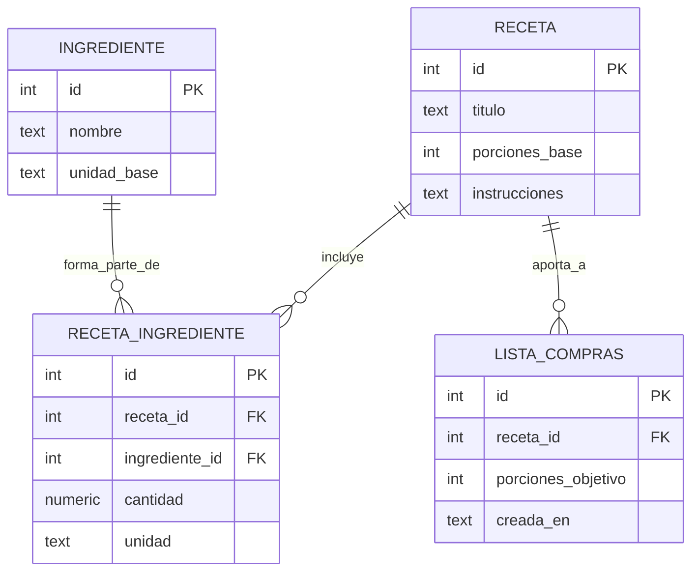

# PRD · Las recetas de betty.

> Documento de requisitos del producto (Product Requirements Document).
> Complétalo en el Sprint 0 (historia H0.3) y pide la aprobación del profesor en un Issue.
> Cada requisito funcional (RF) se convierte en un Issue con la plantilla "Historia de usuario".

| Campo | Valor |
| --- | --- |
| Alumno | Betania Inmaru Marcano Lopez|
| Proyecto n.º | Sistema de recetas con escalado y consolidacion (hash) |
| Sitio de referencia | Allrecipes|
| Compañero revisor | por asignar |
| URL desplegada | (se completa en el Sprint 5) |

## 1. Problema

Al preparar varias recetas o adaptar una preparación para más o menos invitados, calcular manualmente las proporciones de cada ingrediente genera errores de medición y desperdicio. Además, al planificar compras para varias recetas a la vez, los ingredientes repetidos quedan dispersos, provocando compras duplicadas o ingredientes olvidados.

## 2. Usuarios

- **Usuario principal:** Personas que cocinan en casa o gestionan pequeños emprendimientos de repostería y cocina, que necesitan guardar recetas, escalar porciones al instante y consolidar una única lista de compras desde computadora o teléfono.
- **Usuario secundario:** Compañeros de cocina o familiares que consultan las recetas ya escaladas y la lista de compras consolidada para adquirir los insumos.

## 3. Objetivo y métrica de éxito

Ejemplo: «permitir escalar porciones de recetas y consolidar una lista de compras sin ingredientes duplicados en menos de un minuto.».

## 4. Alcance del MVP

Entre 5 y 8 funcionalidades que SÍ entran este semestre.

1. Registro y consulta de recetas e ingredientes.
2. Escalado dinámico de porciones según cantidad deseada.
3. Consolidación de ingredientes para lista de compras usando tablas hash.
4. Búsqueda y filtrado de recetas por nombre o ingrediente.
5. Consulta de historial de porciones escaladas y listas de compras.

### Funcionalidades → carpetas de `src/` (screaming architecture)

Cada funcionalidad del alcance será una carpeta en `src/`. Nómbralas en inglés y en plural.

| Funcionalidad | Carpeta |
| --- | --- |
| Gestión de recetas e ingredientes |`src/recipes`  |
| Escalado dinámico de porciones |`src/scalings` |
| Lista de compras consolidada | `src/shopping-lists` |
| Búsqueda y filtrado de recetas | `src/searches` |
| Historial de escalados y listas | `src/histories` |

## 5. Fuera de alcance

Lo que NO vas a construir.

- Pagos en línea, integración con supermercados externos o funciones sociales complejas

## 6. Requisitos funcionales

| ID | Requisito | Prioridad (alta, media, baja) |
| --- | --- | --- |
| RF-01 | Registrar, consultar, editar y eliminar recetas con sus ingredientes y unidades | alta |
| RF-02 | Calcular el escalado dinámico de cantidades según las porciones deseadas | alta |
| RF-03 | Consolidar ingredientes de recetas seleccionadas mediante tablas hash sin duplicados | alta |
| RF-04 | Buscar y filtrar recetas por nombre o ingrediente | media |
| RF-05 | Consultar el historial de porciones escaladas y listas de compras generadas | baja |

## 7. Requisitos no funcionales

- Responsive, móvil primero (375 px y 1280 px).
- Lighthouse ≥ 90 en Accesibilidad y Buenas prácticas.
- 0 errores en la consola del navegador.
- Funciona con 10.000 registros sin congelarse.

## 8. Modelo de datos

Diagrama entidad-relación y tablas PostgreSQL con tipos, claves y restricciones.
GitHub dibuja diagramas Mermaid; edita este ejemplo:

## 9. Reto técnico distintivo

Consolidar ingredientes repetidos de varias recetas escaladas mediante tablas hash (evitando duplicados y manejando normalización de nombres y unidades) con un tiempo de respuesta rápido y sin depender de estructuras automáticas donde se requiera implementación propia.

## 10. Riesgos y preguntas abiertas

- Diferencias en unidades de medida entre recetas (por ejemplo, gramos, mililitros o unidades) al sumar ingredientes en la lista consolidada.
- Normalización de nombres de ingredientes (mayúsculas, acentos o plurales) para que la clave hash agrupe el mismo insumo.
- Definición de las migraciones iniciales de tablas en PostgreSQL antes de avanzar a los siguientes sprints.
